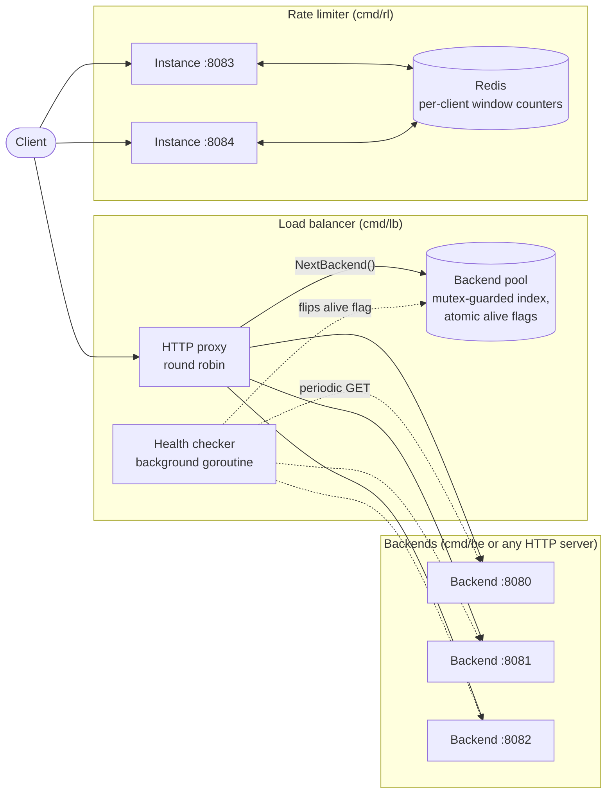

# Go Load Balancer & Distributed Rate Limiter

Two small network services written in Go from first principles:

- a **round-robin HTTP load balancer** with background health checks, and
- an **API rate limiter** with four algorithms, including a **Redis-backed** version whose limit is shared across multiple server instances.

Both follow the specs from John Crickett's Coding Challenges ([Load Balancer](https://codingchallenges.fyi/challenges/challenge-load-balancer), [Rate Limiter](https://codingchallenges.fyi/challenges/challenge-rate-limiter)). Those challenges are language-agnostic specs with no reference code, so the Go implementation here is written from the spec.

## Why these two together

A load balancer spreads traffic evenly across healthy backends. It has no idea whether one client is sending too much, so a flood from a single client is faithfully distributed across *every* backend instead of overwhelming just one. A rate limiter rejects the excess before it costs backend capacity.

Scaling out creates a second problem: with an in-memory counter, each instance only sees its own slice of a client's traffic, so a limit of 60 requests/minute silently becomes up to `60 × N` across `N` instances. Moving the counters into Redis gives every instance the same view, so the limit holds regardless of which instance a request lands on. That shared-state step is the main reason the two projects belong in one repo.

## What's implemented

### Load balancer (`cmd/lb`, `loadbalancer/`)

- Round-robin distribution across a configurable backend list
- Round-robin index guarded by a `sync.Mutex` (many request goroutines pick backends concurrently)
- Background health checker: periodically GETs a configurable path on each backend, removes failing backends from rotation, and re-adds them when they recover
- Per-backend alive flag stored as an `atomic.Bool`
- Concurrent request handling (one goroutine per connection via `net/http`)
- `503` if no healthy backend exists, `502` if forwarding to a chosen backend fails

### Rate limiter (`cmd/rl`, `ratelimiter/`)

Every algorithm implements the same one-method interface (`Allow(key string) bool`) and is selected with `--strategy`. The key is the client IP (port stripped). Rejected requests get HTTP `429 Too Many Requests`.

| `--strategy` | Algorithm | Parameters (set in `cmd/rl/main.go`) | State |
|---|---|---|---|
| `token-bucket` | Token bucket, one bucket per IP | capacity 10, refill 1 token/sec | in-process |
| `fixed-window` | Fixed window counter | 60 requests per 60 s window | in-process |
| `sliding-window-counter` | Weighted current + previous window | 60 requests per 60 s window | in-process |
| `redis-sliding-window` | Sliding window counter, shared via Redis | 60 requests per 60 s window | Redis |

The sliding window counter estimates the request rate as `previous_count × (1 − elapsed_fraction) + current_count` and rejects when the estimate reaches the threshold. This avoids the fixed window's boundary burst (up to 2× the limit around a window edge) while storing only two integers per client.

Endpoints: `/limited` (rate limited) and `/unlimited` (control).

The challenge's sliding window log step was intentionally skipped.

## Architecture



The two subsystems currently run as **independent processes**. Putting the rate limiter in front of the load balancer (client → rate limiter → load balancer → backends) is the intended deployment but is not wired up in this repo (see [Limitations](#known-limitations)).

## Project layout

```
.
├── cmd/
│   ├── lb/main.go        # load balancer entrypoint
│   ├── be/main.go        # tiny test backend
│   └── rl/main.go        # rate limiter API server
├── loadbalancer/
│   └── pool.go           # backend pool, round robin, health checks
├── ratelimiter/
│   ├── limiter.go                    # Limiter interface
│   ├── tokenbucket.go
│   ├── fixedwindow.go
│   ├── slidingwindowcounter.go
│   └── redis_sliding_window.go
├── docker-compose.yml    # Redis
└── go.mod
```

## Getting started

**Prerequisites:** Go 1.21+ (uses the built-in `min` and `atomic.Bool`), Docker (for Redis), and `curl`.

```bash
git clone https://github.com/<your-username>/<repo-name>.git
cd <repo-name>
go mod download
```

### Run the load balancer

Use one terminal per process.

```bash
# terminals 1-3: three backends
go run ./cmd/be --port 8080
go run ./cmd/be --port 8081
go run ./cmd/be --port 8082

# terminal 4: the load balancer
go run ./cmd/lb --port 9090 \
  --backends http://localhost:8080,http://localhost:8081,http://localhost:8082 \
  --health-path / --health-period 5s

# terminal 5: send traffic
curl http://localhost:9090/
```

Any HTTP server works as a backend, e.g. `python -m http.server 8080`.

Flags: `--port` (default `9090`), `--backends`, `--health-path` (default `/`), `--health-period` (default `10s`).

### Run the rate limiter

```bash
go run ./cmd/rl --port 8083 --strategy token-bucket
curl http://127.0.0.1:8083/unlimited
curl http://127.0.0.1:8083/limited
```

Flags: `--port` (default `8080`, so pass a different port if your backends are using it), `--strategy`, `--redis-addr` (default `localhost:6379`).

### Run the distributed (Redis) rate limiter

```bash
docker-compose up -d        # or: docker compose up -d

go run ./cmd/rl --port 8083 --strategy redis-sliding-window
go run ./cmd/rl --port 8084 --strategy redis-sliding-window
```

## Verifying behavior

Fire 10 concurrent requests (Git Bash / Linux / macOS):

```bash
for i in $(seq 1 10); do curl -s -o /dev/null -w "%{http_code}\n" http://127.0.0.1:8083/limited & done; wait
```

| Strategy | What you should see |
|---|---|
| `token-bucket` | First burst: all `200` (bucket starts full at 10). Run it again straight away: mostly `429`, with roughly one `200` per second elapsed since the first burst. After ~10 s idle, a full burst succeeds again. |
| `fixed-window` | Requests succeed until 60 have been served in the current 60 s window, then everything is `429` until the window rolls over, at which point a fresh 60 are allowed. |
| `sliding-window-counter` | Same limit, but the previous window's count keeps counting against you for part of the new window, so a burst right after a window edge is rejected far more than with `fixed-window`. |
| `redis-sliding-window` | See below. |

**Proving the limit is shared across instances:**

```bash
# send 60 requests to instance 1
for i in $(seq 1 60); do curl -s -o /dev/null http://127.0.0.1:8083/limited; done

# instance 2 has seen zero requests itself, but should now reject
curl -i http://127.0.0.1:8084/limited     # expect HTTP 429
```

Counters from the previous window still carry weight, so wait ~2 minutes between experiments or reset Redis:

```bash
docker-compose exec redis redis-cli FLUSHALL
```

**Load balancer failover:** kill one backend, wait one `--health-period`, and confirm the load balancer logs the backend being taken out of rotation and requests keep succeeding on the rest. Restart the backend and it rejoins after the next check.

All testing so far has been manual with `curl`.

## Design notes

- **Mutex vs atomic.** The round-robin index and the backend list are related state, so they sit behind a `sync.Mutex`. Each backend's alive flag is one independent value, so it is an `atomic.Bool`.
- **Redis layout.** Each client has one counter key per window (`rl:<ip>:<window-index>`) with a TTL of 2× the window, so the current and previous windows are always available and old keys expire on their own.
- **Pluggable algorithms.** A one-method `Limiter` interface lets `main.go` swap algorithms without changing the HTTP handler.

## Known limitations

**Rate limiter**

- **The Redis check-and-increment is not atomic.** It does a `GET`, computes the estimate, then `INCR`s. Two requests arriving simultaneously near the threshold can both read the same count, so a few may slip past the exact limit. A Lua script (`EVAL`) would make check-and-increment a single atomic operation.
- **It fails open if Redis is unreachable.** Redis errors are not handled, so a failed read returns a count of 0 and requests are allowed through.
- **In-process limiters never evict idle clients.** Their per-IP maps grow with the number of distinct clients seen.
- **Clients are identified by `RemoteAddr`.** Behind any proxy, including this repo's load balancer, every request would appear to come from the proxy's IP unless the proxy forwards the real client address (for example via `X-Forwarded-For`), which this repo does not do. Locally, every `curl` comes from the same loopback address, so you cannot simulate multiple clients.
- **Strategy parameters are constants in `cmd/rl/main.go`**, not flags.

**Load balancer**

- **It forwards only the request path, using GET.** Query strings, request headers, request bodies and non-GET methods are not forwarded. Replacing the manual forwarding with `httputil.ReverseProxy` would fix this.
- **Failure detection is periodic only.** A backend that dies between health checks keeps receiving traffic (and returning `502`) until the next check, and there is no retry on another backend. The first health check runs one period after startup.
- **No timeouts** are configured on outbound requests or health checks.

**General**

- The rate limiter and load balancer are not chained together yet.
- No automated tests; verification is manual.

## Possible next steps

- Chain the two: rate limiter as middleware in front of the load balancer
- Make the Redis check-and-increment atomic with a Lua script, and decide on fail-open vs fail-closed behavior
- Automated tests with Go's `testing` package and the race detector (`go test -race ./...`)
- Switch the proxy to `httputil.ReverseProxy`, add timeouts, forward client IP
- Run the whole stack from `docker-compose.yml`
- Implement the sliding window log algorithm and compare its memory cost against the counter

## Credits

Specs from [Coding Challenges](https://codingchallenges.fyi) by John Crickett.